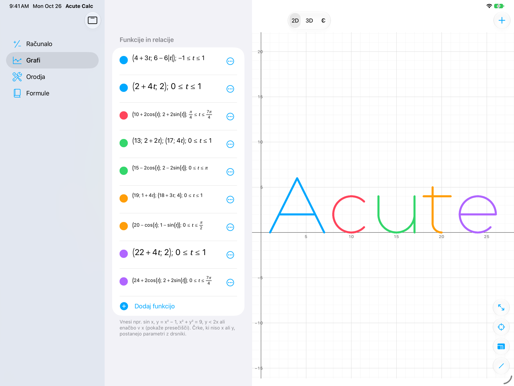
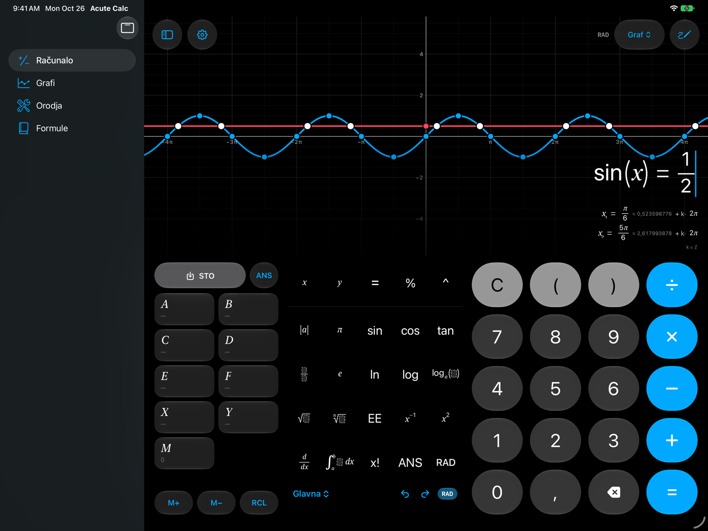
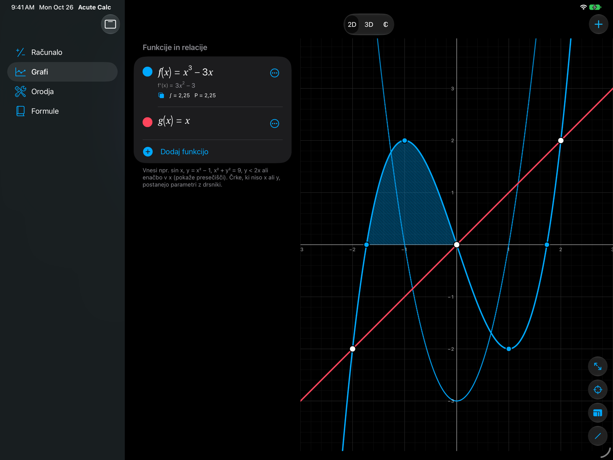
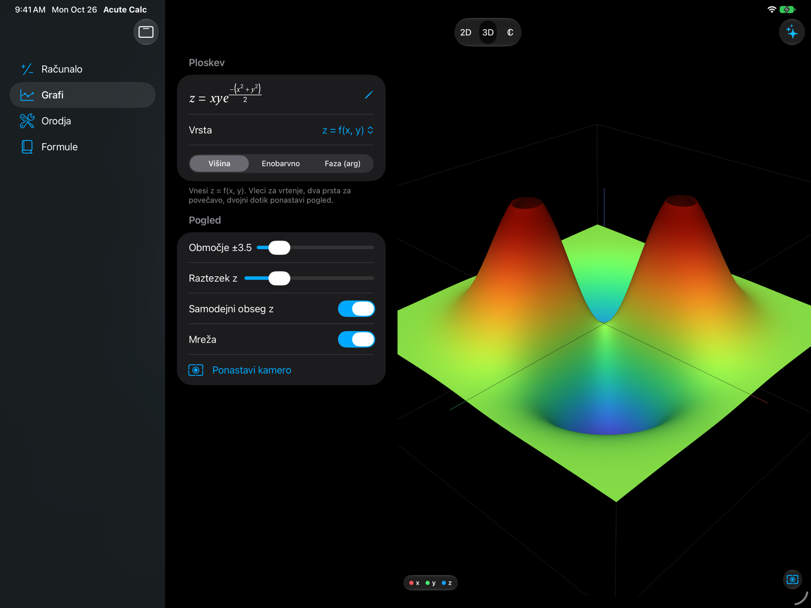
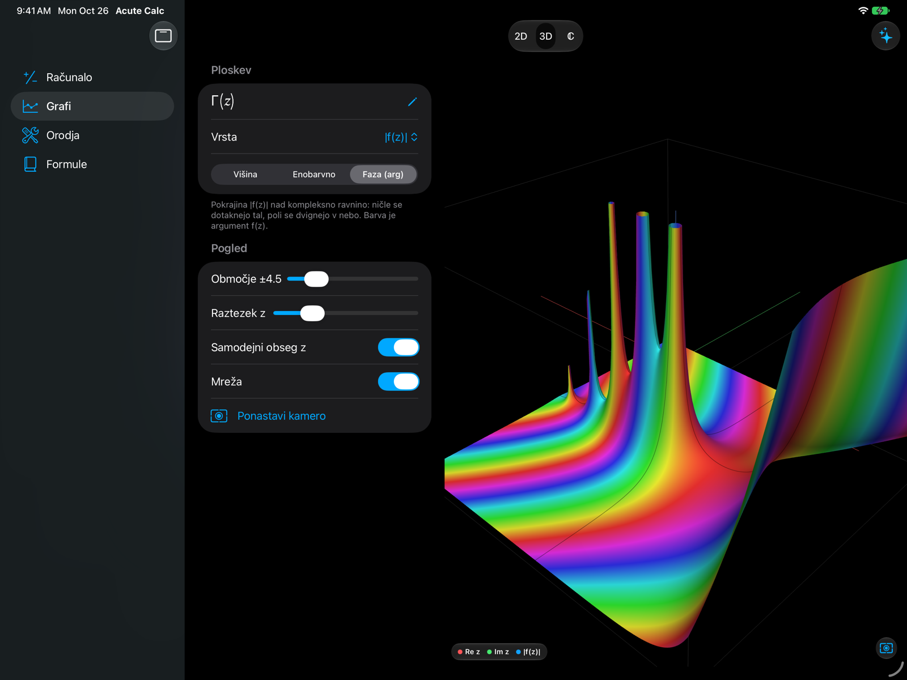
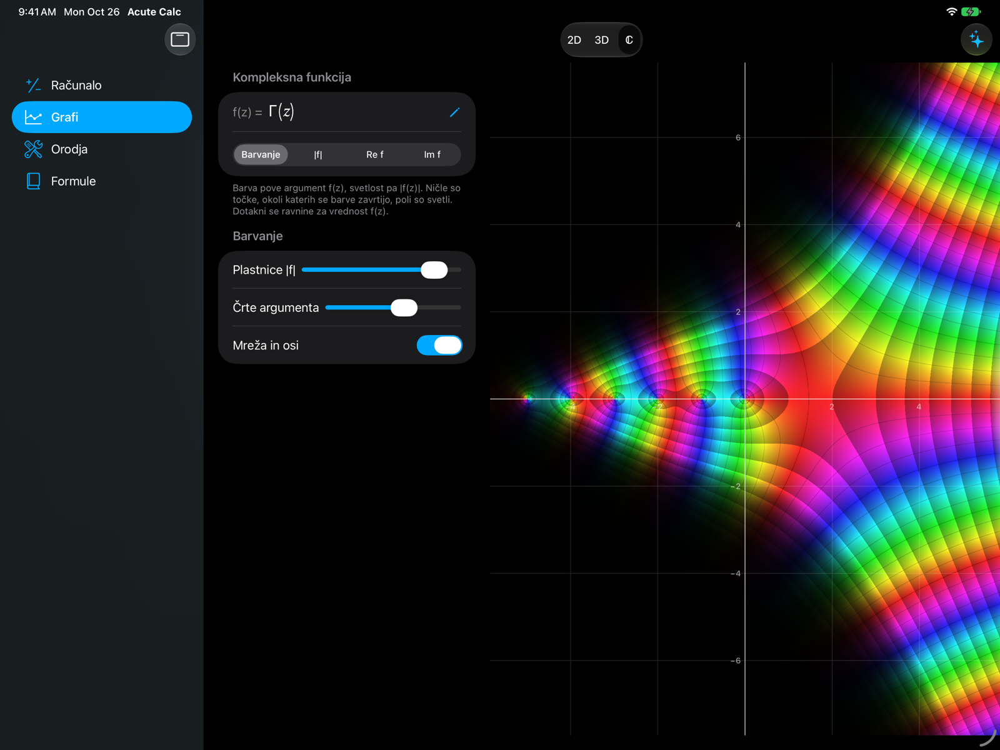
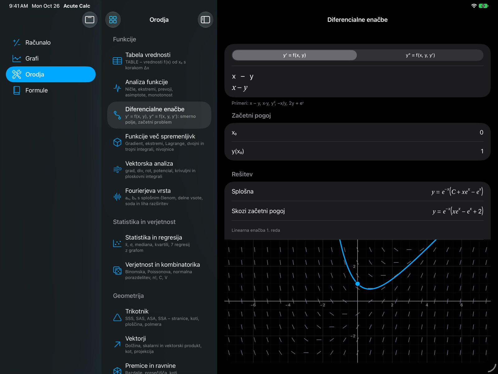
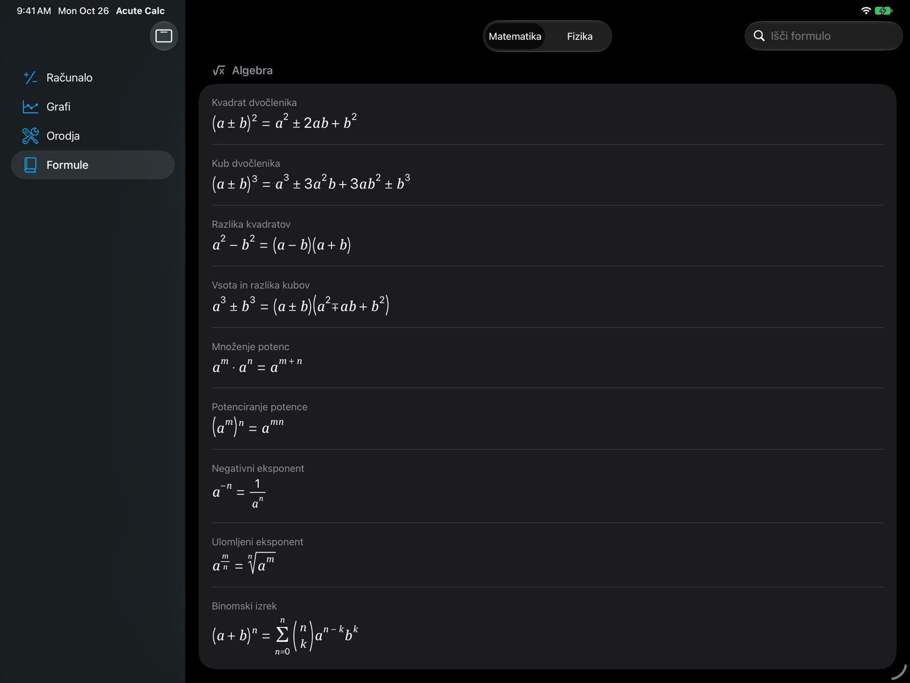

<div align="center">

# Acute Calc 2

**A structured graphing calculator for iPhone and iPad that computes everything on the device —<br>
made for the Slovenian matura and the first year of university.**

[](https://github.com/MarkPLacer/AcuteCalc/actions/workflows/build.yml)
[](https://github.com/MarkPLacer/AcuteCalc/releases/latest/download/AcuteCalc.ipa)


[Install and update](#install-and-update) · [Getting started](#getting-started) · [Features](#features) · [Building](#building)

</div>

<picture>
  <source media="(prefers-color-scheme: dark)" srcset="docs/screenshots/graphs-dark.png">
  
</picture>

<p align="center"><sub>Nine parametric curves draw the word “Acute” in Grafi on an iPad Pro 13″.
Try it yourself: <b>Grafi → + → Primeri → Napis Acute</b>.</sub></p>

Acute Calc 2 is a modern rebuild of *Acute Calculator*, a structured ("WriteView") scientific
calculator with GPU-accelerated graphing that is no longer available. You type math the way it
is written in exercises and see the exact result and the graph while you type. It is made for
studying for the Slovenian **splošna matura** in mathematics and physics and for the first year
at the University of Ljubljana (FE and FGG).

Everything is computed on the device — no accounts, no in-app purchases, every feature is
unlocked. The only network request is an optional check for a newer build (see
[Install and update](#install-and-update)).

> [!NOTE]
> Acute Calc is not on the App Store. Every green build of `main` publishes an unsigned IPA
> and an app source for AltStore, SideStore, Feather and eSign, see
> [Install and update](#install-and-update).

## Install and update

The rolling release [latest](https://github.com/MarkPLacer/AcuteCalc/releases/tag/latest)
carries an app source that AltStore, SideStore, Feather and eSign can add, so they install the
newest build, show its changelog and offer every new one as an update:

```
https://github.com/MarkPLacer/AcuteCalc/releases/download/latest/apps.json
```

| App | Add the source |
| --- | --- |
| Feather | Sources › + › paste the link (or open `feather://source/<link>`) |
| eSign | Sources › + › paste the link |
| SideStore, AltStore | Sources › + › paste the link |

Or download **[AcuteCalc.ipa](https://github.com/MarkPLacer/AcuteCalc/releases/latest/download/AcuteCalc.ipa)**
and sign it with your own Apple ID, for example with [Sideloadly](https://sideloadly.io), or
with a signing service. Acute Calc needs iOS or iPadOS 27.0 or later; the version is shown in
Nastavitve.

> [!TIP]
> An app signed with a free Apple ID stops opening after 7 days; AltStore and SideStore can
> refresh it for you.

The app reads the same source: when a newer build is out it shows an update popup with the
changes and a button that hands the IPA to Feather, SideStore, AltStore or eSign — picked in
the popup the first time and remembered on each device (also in Nastavitve › Posodobitve ›
Namesti z) — or opens the release. With both automatic checks and notifications on
(Nastavitve › Posodobitve), iOS also runs the check now and then in the background (Background
App Refresh, when iOS decides) and the app posts a local notification — no push server or push
entitlement needed.

## Getting started

The app is in Slovenian and has four sections: **Računalo**, **Grafi**, **Orodja** and
**Formule** (a sidebar on iPad, the menu at the top left on iPhone).

| Type | In | You get |
| --- | --- | --- |
| `sin x = 1/2` | Računalo | the exact periodic solutions, with both sides drawn above |
| `x² + y² = 25` | Računalo or Grafi | the circle, drawn exactly per pixel |
| `x ≥ 0, y ≥ 0, x + y ≤ 4` | Grafi | the region where all three hold |
| `(cos t, sin t), 0 ≤ t ≤ π` | Grafi | a parametric curve, here a semicircle |
| `(x − n)² + y² ≤ 2^(−n−1), n ∈ ℕ` | Računalo or Grafi | the union of the discs D₁ ∪ D₂ ∪ … and its area π/2 |
| `f(x) = x³ − 3x` | Grafi | zeros, extrema and the inflection point; the row's ⋯ menu adds f′, shading, a table and the full analysis |

- Type with the keypad, a hardware keyboard (`sin`, `sqrt`, `alpha` … turn into math) or the
  Apple Pencil (Scribble). The result updates as you type; **=** keeps it in the history.
- **CHANGE** switches the form of a result: decimal, fraction, mixed number, D°M′S″, SCI, ENG …
- In Grafi every row is a function, a relation or a curve; letters other than x and y become
  sliders. **+ → Primeri** has ready-made examples.

## Features

**Calculator**



<p align="center"><sub>sin x = 1/2: x = π/6 + 2kπ or x = 5π/6 + 2kπ, with both sides drawn above on an x axis in multiples of π.</sub></p>

- Structured math editor: fractions, roots, powers, |x|, logₐ, d/dx, ∂/∂x, ∫, Σ, Π, lim,
  binomials, matrices and vectors (drag the size badge to resize), piecewise functions,
  sin²x / sin⁻¹x notation, Greek letters, vector arrows
- Live results with exact forms (fractions, surds, π), Sharp-style CHANGE
  (decimal, fraction, mixed, recurring, D°M′S″, SCI, ENG, prime factors), complex results
- Equations (exact roots, exponential substitution, periodic trig solutions, complex roots),
  inequalities as intervals (also systems and chains, periodic for trig), limits, improper
  integrals, infinite series, symbolic derivatives
- Matrices & vectors with exact fractions: det, inverse, transpose, rank, dot/cross product,
  angles, linear systems
- History, memories A–F/X/Y/M (numbers or matrices), STO/RCL, M+/M−, ANS
- Long-press-and-drag selection with an edit bar, auto-closing parentheses, (−) key,
  undo/redo (UndoManager: ⌘Z, three-finger swipe), system copy/cut/paste (⌘C/⌘X/⌘V),
  LaTeX import/export, hardware keyboard (typing `sin`, `sqrt`, `alpha` … turns into math),
  Apple Pencil Pro squeeze & double tap, Scribble

**Graphs** (Metal 4, 120 Hz)



<p align="center"><sub>f(x) = x³ − 3x with its zeros, extrema and inflection point, the derivative f′,
∫ from −√3 to 0 shaded, and the intersections with g(x) = x.</sub></p>

- 2D: explicit, implicit and inequality graphs, parameters with animated sliders, special
  points (zeros, extrema, inflections, holes, intersections), tracing with tangent, shaded
  definite integrals (also between two curves), derivatives, Taylor polynomials, tables,
  full function analysis
- Input as in exercises: `f(x) = …`, `v(t) = …`; systems separated by commas
  (`x ≥ 0, y ≥ 0, x + y ≤ 4` → region, `y = 2x + 1, y = 4 − x` → intersection,
  `x² + y² = 4, y ≥ 0` → semicircle); chains `−1 ≤ y < 2`; sets of complex numbers
  (`|z − 1| ≤ 2`, `Re z ≥ −2`, `1 ≤ |z| ≤ 2`)
- Infinite unions of regions: `(x − n)² + y² ≤ 2^(−n−1), n ∈ ℕ` (also `n ∈ ℕ₀`, `n = 1, 2, …`,
  typed `n in N`) shades D₁ ∪ D₂ ∪ … down to the members smaller than a pixel; when the members
  are discs or ellipses that do not overlap, the area is the sum of theirs — exact for a geometric
  series (here π/2), otherwise with an error bound — and overlapping members make it an upper bound
- Lines and conics in general form (circles, ellipses, hyperbolas, parabolas) are drawn
  exactly per pixel and analysed through their branches (vertices, intercepts, intersections)
- Equal scale on both axes by default (circles stay round); "fit" frames closed curves
- Rows can use each other (`g(x) = f(x − 2) + 1`), the calculator evaluates `f(2)`;
  inverse function and integral function ∫₀ˣ f per row; piecewise derivatives
- Dashed asymptotes (also of hyperbolas), filled/hollow ends of piecewise pieces, angle
  between curves at intersections, tangent and normal equations while tracing
- Sequences as points (`a_n = …`), points and polygons with area and perimeter
  (`A(1, 2), B(4, 5), C(6, 1)`), data polylines with the area under them, complex numbers
  and plane vectors as arrows (sums with the parallelogram)
- The x axis in multiples of π for trigonometric graphs
- Logarithmic x and y axes (Nastavitve › Grafi) for quantities over many powers of ten, such as
  frequencies from 10⁰ to 10²⁰ Hz: decade grid with 2 … 9 between, labels 1, 10, 100, 10³ …,
  panning and pinching in decades; curves, points, special points, intersections and the
  tangent while tracing follow the scale, values ≤ 0 are not drawn
- 3D: z = f(x, y), solids of revolution, complex landscapes |f|, Re f, Im f
- ℂ: domain colouring (ζ, Γ, …) with probing

<p align="center">
  
  
</p>

<p align="center"><sub>3D: z = x·y·e^(−(x² + y²)/2) with two hills and two valleys, and the landscape |Γ(z)| over the
complex plane, coloured by arg Γ(z); the poles at 0, −1, −2, … rise as spikes.</sub></p>



<p align="center"><sub>ℂ: the domain colouring of Γ(z). The colour is the argument, the brightness bands are the modulus,
and the poles at 0, −1, −2, … sit on the negative real axis.</sub></p>



<p align="center"><sub>Orodja: y′ = x − y with its slope field, the solution through (0, 1) and its closed form.</sub></p>

**Tools**: statistics with the seven Sharp regressions plus the line through the origin
(y = bx, for measurements), linearised axes (1/x, x², √x, ln x), the area under the data
and charts, two data sets side by side (box plots, a table of their measures and the
two-sample tests), an amortization plan, binomial / Poisson /
normal distributions, combinatorics, triangle solver, vectors (drawn in a 3D sketch that
turns), solids (cube, cuboid, regular prisms and pyramids, frustum of a pyramid, cylinder,
cone and its frustum, sphere: volume, surface area and the lengths and angles of each shape,
such as diagonals, heights, side edges and radii; a cube, pyramid, cone or sphere also from
other usual givens, hidden edges dashed), sets (intervals, numbers and inequality solutions
on the number line with ∪, ∩, \ and complements; Venn diagrams of two or three sets with the
shaded expression and the counts of every region), linear systems, complex numbers,
sequences, interest, N-BASE with logic operations, DRILL, lenses and mirrors (the image from
1/f = 1/a + 1/b, its size and nature, and its construction with the principal rays), unit
converter, CODATA 2022 constants.

**University tools** (first year at UL FE and FGG): differential equations (slope field,
initial value problems, closed forms checked by substitution), functions of several
variables (gradient, Hessian, tangent plane, extrema with and without constraints, double
and triple integrals in Cartesian, polar, cylindrical and spherical coordinates, contour
lines, Jacobians), vector analysis (div, curl, potentials, line and surface integrals),
Fourier series with general terms, Student t / χ² / F distributions with confidence
intervals and tests (t-test, χ² goodness of fit, ANOVA, χ² independence, correlation,
two-sample t-test with a pooled variance or Welch's method, F-test of two variances),
lines and planes in space with a 3D sketch of their intersections and perpendiculars,
cross-sections (centroid, second moments, principal axes), beams (reactions, shear and
moment diagrams), plane trusses (method of joints), circuit analysis (nodal analysis in
DC and with phasors, Thévenin and Norton sources) and surveying (direction angle, polar
method, intersections, resection, Gauss area, Helmert transformation, least squares
adjustment, spherical triangles, great circle and rhumb line). In the calculator: `eig`,
`charpoly`, `rref`, `ker`, `tpdf`/`tcdf`/`invT`, `χ²pdf`/`χ²cdf`/`invχ²`,
`fpdf`/`fcdf`/`invF`.

**Formulas**: matura formula sheets for mathematics and physics (rendered from LaTeX).



## Technology

- **SwiftUI** + **Liquid Glass**, Swift 6.4 language mode with default `MainActor` isolation
- **Metal 4** renderers (`MTL4CommandQueue`, argument tables, residency sets) with a Metal 3
  fallback; expressions run on the GPU through bytecode interpreters (real, dual numbers for
  normals, complex with Lanczos Γ and Borwein ζ)
- **AcuteCore**: a platform-independent math engine (Swift package) with tests — parser,
  exact arithmetic, CAS, solvers, numerics, statistics, matrices, LaTeX, formula library

## Building

The app is built on GitHub Actions (`runs-on: xcode-27`, Xcode 27.1, iOS 27.1 SDK,
deployment target iOS 27.0). Every push to `main` produces an **unsigned IPA** artifact
(`AcuteCalc-unsigned-ipa`); a simulator smoke test types sample input into the calculator
and the Graphs tab. When all checks pass, the IPA replaces `AcuteCalc.ipa` in the rolling
release **latest** (no new release per commit):
https://github.com/MarkPLacer/AcuteCalc/releases/latest/download/AcuteCalc.ipa. The build
number is the CI run number, and the version is `major.minor` of `MARKETING_VERSION` plus the
run number (e.g. 2.0.42, shown in Nastavitve), because Feather and SideStore detect updates by
the version alone. Pushing a tag `v*` also attaches the IPA to a versioned release.

```
swift test --package-path Packages/AcuteCore     # math engine tests (macOS)
xcodebuild -project AcuteCalc.xcodeproj -scheme AcuteCalc -sdk iphoneos \
  -configuration Release CODE_SIGNING_ALLOWED=NO build
```

`scripts/altsource.py` builds the app source from each IPA: the changelog lists the commits
since the previous release, and the one version points to the release's only IPA,
`AcuteCalc.ipa`, with the size and SHA-256 that AltStore and SideStore verify (if one of them
reports a mismatch right after a new build, refresh the source). The changelogs of the last ten
builds stay in `changelog`, which only the app reads. The flat `version`/`downloadURL` fields
repeat the newest version for eSign.

The screenshots in this README come from the **Screenshots** workflow (run it from the Actions
tab): the UI test `AcuteCalcScreenshots` launches the app once on an iPad Pro 13-inch (M5)
simulator and captures every scene of `AcuteCalc/App/Showcase.swift` in dark and light
appearance as soon as it has settled, and the `small` images of its artifact go to
`docs/screenshots`. To see a branch without a Mac, `bash scripts/screens.sh -s graphs,calculator`
runs the workflow for it and downloads the pictures (see `.claude/skills/screens`).

## Layout

| Path | Contents |
| --- | --- |
| `Packages/AcuteCore` | Math engine + tests (no UI) |
| `AcuteCalc/Calculator` | Calculator screen, keypad, palettes, results, history |
| `AcuteCalc/MathField` | Math layout engine, editor view, clipboard |
| `AcuteCalc/Graphing`, `Graph3D`, `ComplexPlot` | Graph workspaces |
| `AcuteCalc/Rendering` | Metal 4 / Metal 3 renderers and shaders |
| `AcuteCalc/Tools`, `AcuteCalc/Formulas` | Tools and formula sheets |
| `AcuteCalc/Updates` | Update check, popup, notifications (feed model in `AcuteCore/Updates`) |
| `scripts/altsource.py` | Builds the app source (`apps.json`) for the latest release |
| `scripts/screens.sh` | Screenshots of a pushed branch from the Screenshots workflow |
| `AcuteCalc/Resources` | Icon Composer app icons (4 variants) and assets |
| `AcuteCalcScreenshots` | UI test that takes the screenshots |
| `docs/screenshots` | README screenshots (iPad Pro 13-inch) |

## Feedback

Found a wrong result or a matura exercise the app cannot draw? Please
[open an issue](https://github.com/MarkPLacer/AcuteCalc/issues) with the input you typed and
a screenshot.

## Acknowledgments

Inspired by the original *Acute Calculator*, which is no longer available. Acute Calc 2 is an
independent rebuild and is not affiliated with the original app or its author.
